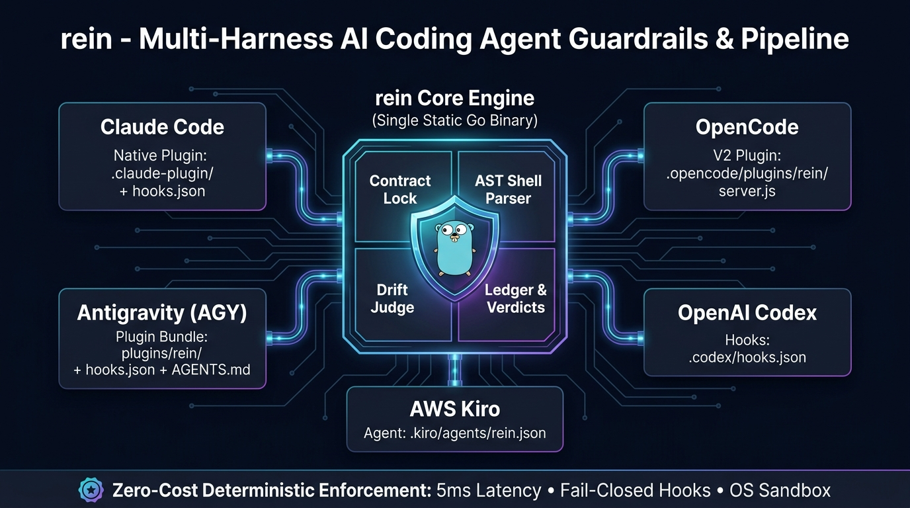

# rein

**Keep cheap and fallback worker models on task.**



When a multi-agent pipeline runs out of quota and falls back to smaller or free models, the work tends to drift:
edits outside the task, "done" claims that are not true, a `git push` nobody asked for, or a command against the
live stack. `rein` holds the reins with three deterministic layers, so the judgement does not depend on the model
behaving well.

```
                 ┌──────────── task contract (rein contract) ────────────┐
                 │ allow / deny globs · scope ids · report path · profile │
                 └──────────────┬─────────────────────────┬──────────────┘
          while the worker runs │                         │ when the worker says "done"
                                ▼                         ▼
                  guard hook (rein hook)          drift check (rein drift)
                  Claude, codex, agy, kiro,       every vendor: Claude, codex,
                  opencode workers                Gemini/Antigravity, opencode, kiro
                  blocks the action now           judges the result
                                │                         │
                                └──── under an OS sandbox (the real wall) ────┘
```

| Layer | Covers | Catches |
|---|---|---|
| **Contract** | everyone | the rules: which files the task may edit, which never, which scope items the report must cover |
| **Guard hook** | Claude Code workers (plugin hook), and codex, agy, kiro, opencode and Hermes workers after `rein hooks install <task>` (one judge, one contract; vendor differences in [`docs/SETUP.md`](docs/SETUP.md) section 8) | `git push` / rebase / `reset --hard`, `gh` / `glab`, docker prune, dependency installs, writes outside the worktree, writes to never-edit or out-of-ownership files, overwriting other tasks' reports or the contract, stopping without a report; plus your project's protected containers, ports, scripts and commands |
| **Drift check** | every vendor | a guard that never ran (`GUARD_INACTIVE`: hooks installed but no hook call in the seen log), out-of-scope or never-edit files in the diff (renames included), uncommitted work, scope items without a heading/status/evidence, files claimed but not changed, `TODO`/`.skip`/stubs, secrets, missing issue refs, size budget |

The guard parses each Bash command with a real shell grammar ([mvdan.cc/sh](https://github.com/mvdan/sh)), so
`bash -c "git -C . push"`, `env X=1 timeout 30 git push` and `echo $(git push)` are caught, while
`git add . && git commit -m "explain why workers never git push"` is not blocked.

> **The guard is a seatbelt, not a wall.** It cannot see writes made through interpreters (`python -c`, `node -e`).
> Pair it with an OS sandbox (Claude Code's Bash sandbox, `codex -s workspace-write`) and always run `rein drift`.

## Multi-Harness Plugin Bundle & Installation

[**Crux**](plugins/crux/README.md) is the separate ADLC workflow plugin: shared engineering playbooks, a session-scoped mode module, and native adapters for Claude Code, Codex, Antigravity and OpenCode2. It builds on Rein's existing execution interfaces; live four-harness activation and cross-provider continuation remain unverified.

`rein` delivers unified deterministic guardrails across **5 major AI coding harnesses**:

| Harness | Bundle Type | Configuration Path | How to Install |
|---|---|---|---|
| **Claude Code** | Native Plugin | `.claude-plugin/plugin.json`, `hooks/hooks.json` | `/plugin marketplace add voravitl/rein` && `/plugin install rein@rein` |
| **Antigravity (AGY)** | Plugin Bundle | `plugins/rein/plugin.json`, `plugins/rein/hooks.json` | `agy plugin install ./plugins/rein` (or `sh scripts/install-harness.sh agy`) |
| **OpenCode** | V2 Plugin | `.opencode/plugins/rein/package.json`, `server.js` | `rein hooks install <task> --vendors opencode` (contracted worktree only) |
| **OpenAI Codex** | Task hooks | `.codex/hooks.json` | `rein hooks install <task> --vendors codex`; use the printed launch flags |
| **AWS Kiro** | Agent Definition | `.kiro/agents/rein.json` | `rein hooks install <task> --vendors kiro`; launch with `--agent rein` |
| **Hermes Agent** | Project plugin + task Hermes home | `<worktree>/.hermes/plugins/rein-guard/` | `rein hooks install <task> --vendors hermes`; start Hermes inside the worktree with `HERMES_ENABLE_PROJECT_PLUGINS=1` and the task's `HERMES_HOME` |

### Quick NPX / Skills CLI Installation

Install rein skills into any agent via community `skills` CLI:
```sh
npx skills add voravitl/rein -g
# or target specific agent and skill:
npx skills add voravitl/rein --skill worktree-pipeline --agent antigravity
```

Run `rein` CLI directly via `npx` without manual setup:
```sh
npx rein version
npx rein --help
```

### One-Click Harness Setup & Uninstall Script

Register native plugin bundles where supported. Task-bound hooks belong in the contract worktree; do not link them globally:

```sh
sh scripts/install-harness.sh all          # attempts each target; unsupported/missing targets return nonzero
# or target a specific harness:
sh scripts/install-harness.sh agy          # Antigravity (Gemini CLI)
rein hooks install <task> --vendors codex   # task hooks + required launch flags
rein hooks install <task> --vendors opencode # project OpenCode plugin
sh scripts/install-harness.sh claude       # Claude Code
rein hooks install <task> --vendors kiro     # task-specific Kiro agent
rein hooks install <task> --vendors hermes   # task-bound Hermes project plugin

# Remove task-bound Rein hooks (preserves other owners):
rein hooks uninstall <task>
# Remove registered Rein native plugins:
sh scripts/install-harness.sh uninstall all
```

### 1. Claude Code
In Claude Code:
```
/plugin marketplace add voravitl/rein
/plugin install rein@rein
```
Start a new session: the plugin's SessionStart hook builds the binary with Go (or downloads the release binary and checks `SHA256SUMS`) into the plugin data dir, which survives updates. Then run `/rein:setup`. Full prerequisites, Orca and OMC integration: [`docs/SETUP.md`](docs/SETUP.md).

| Plugin part | Name |
|---|---|
| Guard hooks | SessionStart (install binary), PreToolUse + Stop (`rein hook`, exec form, silent outside a contracted worktree) |
| Skills | `rein:help` (interactive guide & troubleshooting), `rein:setup`, `rein:worktree-pipeline` (coordinator playbook for Orca), `rein:cli-reference` (all-in-one CLI command manual) |
| Agents | `rein:rein-orchestration` (Universal Master Coordinator & Swarm Orchestrator), `rein:orca-swarm` (Opus coordinator, main session only), `rein:orca-steward` (Sonnet/Haiku mechanical jobs, started as an Orca worker) |

### 2. Antigravity (AGY)
Install natively via `agy` CLI:
```sh
agy plugin install ./plugins/rein
# or: sh scripts/install-harness.sh agy
```
Antigravity automatically loads `plugins/rein/plugin.json`, imports 4 skills, 2 agents, 2 hooks, and enforces `plugins/rein/rules/AGENTS.md`. Verify with `agy plugin list`.

### 3. OpenCode
Generate the OpenCode V2 plugin inside an existing contracted worktree:
```sh
rein hooks install <task> --vendors opencode
# Start OpenCode inside that contract worktree. To remove:
rein hooks uninstall <task> --vendors opencode
```
The generated plugin calls the resolved Rein binary with the exact task and worktree. It must not be installed globally: that would judge other projects against the wrong contract. Restart an already-running harness to unload a plugin it has cached in memory.

### 4. Standalone Static Binary (No Harness Plugin)
Build the single static Go binary directly (Go 1.26+; zero external dependencies):
```sh
git clone https://github.com/voravitl/rein && cd rein
sh scripts/install.sh          # builds bin/rein for this machine
sh scripts/build.sh            # optional: dist/rein-<os>-<arch> + SHA256SUMS for macOS, Linux, Windows
```
The hook is silent unless the session runs inside a git worktree that has a contract, so it is safe to install globally. Measured on Apple Silicon: about 5 ms per call (p50), inside or outside a worker.

## Use

**1. A project profile and pack** (once per project; keep both out of public repos; `/rein:setup` helps):

```sh
mkdir -p ~/.config/rein/profiles ~/.config/rein/packs
cp examples/profile.example.json ~/.config/rein/profiles/myapp.json   # edit containers, ports, scripts
cp -R examples/pack ~/.config/rein/packs/myapp                          # gates, safety notes, rule addenda
```

**2. A contract per task**, written by the coordinator before the worker starts:

```sh
rein contract new --name fix-login --issue 42 --run-dir ~/runs/sprint-7 \
  --profile ~/.config/rein/profiles/myapp.json \
  --allow 'src/auth/**,tests/auth/**' --scope S1,S2,S3 --max-changed-lines 400
```

It prints the ownership block to paste into the worker's spec. The worker's worktree is
`<worktree_root>/<name>`; its report goes to `<run-dir>/reports/<name>.md`.

**2b. Put the worktree in the OS sandbox** (Claude workers; macOS, Linux, WSL2):

```sh
git worktree add ~/worktrees/myapp/fix-login origin/main     # or your orchestrator's "create worktree" step
rein sandbox fix-login                                         # before the worker starts
```

This writes `.claude/settings.local.json` in the worktree: sandbox on, no unsandboxed retries, writes limited to the
worktree, the temp dir and the report file, plus the profile's `sandbox_excluded_commands` (for example your
orchestrator CLI, or a test script that drives docker) and `sandbox_allowed_domains`. Verified on macOS: a
`python -c` write outside the worktree, which the guard cannot see, fails with `Operation not permitted`.
Native Windows has no Claude Code sandbox (use WSL2).

**2c. Guard the other vendors** (codex, agy, kiro, opencode, hermes; after the worktree exists):

```sh
rein hooks install fix-login            # --vendors codex,agy,kiro,opencode,hermes (default) | claude
```

This writes each CLI's project hook file inside the worktree (`.codex/hooks.json`, `.agents/hooks.json`,
`.kiro/agents/rein.json`, `.opencode/plugins/rein/server.js`), every one calling the absolute path of this `rein` with
`hook --vendor X`, keeps them out of git status, records the vendors in the contract, and prints the launch flags each
vendor needs (codex: `--dangerously-bypass-hook-trust` plus `-c hooks...`; kiro: `--agent rein`; hermes: `HERMES_ENABLE_PROJECT_PLUGINS=1` and the task's `HERMES_HOME`). Every hook call
inside a worktree appends a line to `<contracts dir>/seen/<task>.log`; `rein drift` reports `GUARD_INACTIVE` when no
PreToolUse line of the current install (and, with `--expect-guard <vendor>`, of that vendor) exists, which is how a
missing launch flag shows up. When hooks are installed for more than one vendor, `rein drift` refuses to judge (exit 2)
unless you pass `--expect-guard <vendor that ran this task>`, so one vendor's calls never vouch for another's launch. The installed hooks are bound to their task (`hook --vendor X --task <name>`): they
judge that contract even if the CLI reports another directory, and deny when it cannot be loaded.

**3. Judge the result** when the worker reports done (any vendor):

```sh
rein drift fix-login --claimed-files src/auth/login.ts,tests/auth/login.test.ts   # add --expect-guard <vendor> when hooks were installed for several vendors
# exit 0 = no drift (warnings may remain), 1 = drift -> send a fix round, 2 = cannot judge
```

The report must have one heading per scope id with a status (`done`, `partly`, `not done`) and evidence under it.

**4. Track quality and cost per model** (optional):

```sh
rein ledger add --task fix-login --type backend --worker codex:gpt-6.1-sol --reviewer claude:claude-opus-5-5 \
  --rounds 2 --approved --drift 0 --minutes 38
rein ledger report            # rounds-to-approve, blockers, false claims, drift, tokens, credits, USD per model
rein ledger suggest           # routing changes, only when every compared model has >= 3 tasks
```

**5. Find who can take work when a quota runs out** (optional):

```sh
cp examples/fallback-chain.example.json ~/.config/rein/fallback-chain.json   # your providers and chains
rein providers --chain worker:backend --skip-claude
```

Each provider is probed with a one-line prompt and reported as `UP`, `QUOTA` or `DOWN`; the first `UP` member of
each chain is printed. Review chains should only list strong models: when none is up, reviews pause.

## Configuration

| What | Where |
|---|---|
| Contracts (hook lookup) | `~/.cache/worktree-pipeline/contracts/<name>.json`, override `PIPELINE_CONTRACTS` |
| Guard denials log | `~/.cache/worktree-pipeline/logs/guard.log`, override `PIPELINE_LOGDIR` |
| Seen log (proof the guard ran) | `<contracts dir>/seen/<task>.log` (beside the contract index, not `PIPELINE_LOGDIR`): `<ts> <vendor> <event> <tool> gen=<install id>` per hook call in a contracted worktree |
| Default profile | `REIN_PROFILE` |
| Project pack | the profile's `pack` field (read by the worktree-pipeline skill; `PIPELINE_PACK` for `advise.sh`) |
| Plugin binary | `${CLAUDE_PLUGIN_DATA}/bin/rein` (`~/.claude/plugins/data/rein-rein/bin/rein`) |
| Ledger / prices | `PIPELINE_LEDGER`, `PIPELINE_PRICES` (`{"<model>": {"usd_per_mtok": N}}`) |
| Fallback chains | `--config`, `PIPELINE_FALLBACK`, `<bin>/../config/fallback-chain.json`, `~/.config/rein/fallback-chain.json` |

## Status

| | macOS | Linux | Windows |
|---|---|---|---|
| Unit tests + hook smoke test (CI on every push) | ✅ | ✅ | build + `go vet` only; runtime unverified |
| Real Claude Code session: guard hook (exec form) | ✅ verified (manual settings and as plugin) | not yet | not yet |
| Real Claude Code session: plugin SessionStart installer | ✅ verified (`--plugin-dir`) | not yet | not yet |
| Real Claude Code session: `rein sandbox` | ✅ verified | not yet | n/a (no native sandbox; use WSL2) |
| Real runs of `rein hooks install` + guard denial: codex 0.161.0, agy 1.3.1, kiro-cli 2.21.0, opencode2 2.0.20, Hermes 0.21.5 (project plugin) | ✅ verified (push and out-of-ownership writes denied, denial text reached the model) | not yet | not yet |

On Windows the hooks run `${CLAUDE_PLUGIN_DATA}/bin/rein` and rely on Windows finding `rein.exe`; that has not been
seen in a real Claude Code session yet. Git Bash paths (`/c/...`, `/tmp/...`) are mapped to native paths before they
are judged (covered by Windows-targeted build/vet checks). Releases are published from `v*` tags; `scripts/install.sh` and
`scripts/install.ps1` download the matching `rein-<os>-<arch>` asset and verify it against `SHA256SUMS`, so a
machine without Go can install the released binary.

Design and the reasons for Go: [`docs/adr/0001-rein-supervisor.md`](docs/adr/0001-rein-supervisor.md).

## Development

```sh
gofmt -w . && go vet ./... && go test ./...
```

## License

MIT

Crux provider setup: `rein config init --dir ./crux-config` creates private, disabled-by-default configuration for Claude Code, Codex, Antigravity and OpenCode2. Inspect it offline with `rein config check --dir ./crux-config`, or add `--quota orca` to read Orca's cached quota without a model prompt. New setups require a conservative quota veto before probes and launches; exact model windows must be configured. The veto cannot authorize spending or establish launch-account identity, and stale or unknown measurements never imply available allowance. See [configuration reference](docs/CLI_REFERENCE.md#crux-provider-configuration) and the [Crux integration plan](plugins/crux/references/integration-plan.md).
