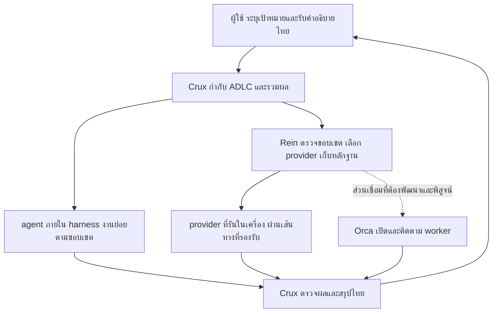

# แบบและแผนเชื่อม Crux กับ Rein และ Orca

เอกสารนี้เป็นแบบและลำดับพัฒนาจากโค้ดปัจจุบัน ไม่ใช่หลักฐานว่าระบบทั้งหมดเชื่อมทำงานจริงแล้ว ขอบเขตบังคับคือ Claude Code, Codex, Antigravity, OpenCode2 และ Hermes Agent ทั้งห้าตัว เป้าหมายคือให้ผู้ใช้สั่งงานผ่าน `crux-mode` จุดเดียว แล้วระบบเลือกวิธีทำงาน แบ่ง agent ส่งต่องาน ตรวจผล และอธิบายสถานะเป็นไทยได้ต่อเนื่อง

## สิ่งที่ผู้ใช้จะได้รับ

### จุดตรวจล่าสุด: 18 ตุลาคม 2026

สถานะรวมยังไม่ครบ เป้าหมายทั้งสี่ harness และ lifecycle ของ Orca ยังคงเดิม ผลทดสอบในเครื่องล่าสุดผ่าน Go 21 แพ็กเกจ แต่ใช้แทนหลักฐานการทำงานจริงทุกเส้นทางไม่ได้

| ลำดับต่อไป | หลักฐานที่มี | สิ่งที่ต้องพิสูจน์ก่อนปิดงาน |
| --- | --- | --- |
| 1. ปิดการส่งงานอัตโนมัติ AGY → Codex | เลือก worker/reviewer อัตโนมัติได้ ผู้ตรวจรับ source/revision ตรงกันและพบข้อผิดพลาดจริง; บันทึกไม่อนุมัติและ settle งบครบ แก้ตัวอย่างแล้วผ่าน 17 กรณี | ให้ผู้ตรวจอิสระตรวจ revision ที่แก้แล้ว โดยไม่ใช้ calibration suite v1 รับรองคุณภาพ |
| 2. ใช้ production supervisor graph ผ่าน Orca terminal | ทางปฏิเสธผ่านแล้ว; worker จำลองทำงานสำเร็จ มี checkpoint/receipt/settlement และ supervisor OS exit 0; completed-graph resume ผ่าน terminal/nonce ใหม่ไม่เรียก worker ซ้ำ ไม่เพิ่ม ledger/hold อ่านผลไทยได้ | ยังต้องพิสูจน์โมเดลจริง, handoff consumer ข้าม provider, crash recovery และ active cancellation/descendants ไม่ใช้ fixture หรือ smoke ที่ประกอบ handoff เองแทน |
| 3. ปิดเกณฑ์ทั้งสี่ harness | มี adapters และผลตรวจแยกตาม harness | activation, continuation, off, guard denial, handoff/cancel และภาษาไทยต้องมีหลักฐานรายตัว; Claude เคยติด weekly quota, OpenCode มีทั้งผลภาษาไทยไม่ผ่านและ paid-model quota เต็ม |
| 4. เชื่อม native Orca lifecycle | ตรวจ ready/live และ effective launch settings ได้ | exact ownership กับหลักฐานจบ/หยุด process และ descendants ก่อนปลด lease, settle หรือ retry; ต้องแยก local กับ federation |

แนะนำทำตามลำดับนี้ เพราะใช้หลักฐานและเส้นทางเดิมก่อนเพิ่ม lifecycle ใหม่ ข้อดีคือลดการเรียกโมเดลซ้ำและแยกสาเหตุผิดพลาดได้ ข้อเสียคือผลผ่านแต่ละขั้นยังใช้รับรองขั้นถัดไปไม่ได้ รายละเอียดผลสดให้บันทึกในรายงานของ run พร้อม revision และ usage จริง ไม่คัดลอกโควตาเก่ามาใช้เป็นสิทธิ์เรียกครั้งใหม่

ข้อจำกัดของหลักฐาน calibration รอบแรก: ตัวอย่างที่ติดป้าย clean ใน suite `crux-remaining-percent-v1` ก็ไม่รองรับจำนวนเต็มขนาดใหญ่ จึงใช้ผลแยกตัวอย่าง 4 ผิด/4 ถูกของ suite นี้รับรองคุณภาพไม่ได้ ต้องเก็บผลเก่าไว้ตามจริง และใช้ suite รุ่นใหม่ที่แก้ ground truth แล้ว ผลการตรวจพบข้อผิดพลาดจาก reviewer จริงมีน้ำหนักเหนือผลผ่านของชุดตรวจที่ยังไม่ครอบคลุม

ผู้ใช้บอกเป้าหมาย เช่น “เพิ่มฟีเจอร์นี้ แยกคนเขียนกับคนตรวจ แล้วสรุปเป็นไทย” Crux แปลงเป็นเกณฑ์ตรวจ เลือกแผนที่เหมาะกับขนาดงาน และดำเนินงานภายในสิทธิ์ที่มี เมื่อเปลี่ยน agent หรือผู้ให้บริการ งานเดิมกับหลักฐานต้องไปถึงผู้รับจริง ผู้ใช้เห็นสิ่งที่เสร็จ สิ่งที่ยังไม่ได้ตรวจ และเหตุผลที่งานติด โดยไม่ต้องแปล log เอง

ADLC ในที่นี้คือวงจรตั้งแต่เข้าใจโจทย์ ออกแบบ พัฒนา รีวิว ทดสอบ จนส่งมอบ ไม่เพิ่มสถานะงานอีกชุดทับ Rein

## ความรับผิดชอบของแต่ละส่วน



เส้นประแสดงจุดที่ยังเชื่อมอัตโนมัติครบวงจรไม่ได้ ส่วน Orca มีคำสั่งเปิด worker แยกอยู่แล้ว แต่ไม่เท่ากับการรองรับ remote graph recovery ของ Rein

| ส่วน | เป็นเจ้าของอะไร | ไม่สร้างซ้ำ |
| --- | --- | --- |
| Crux | เป้าหมาย เกณฑ์ยอมรับ ขั้น ADLC brief แบ่งงาน รวมผล คำอธิบายไทย | lease, retry ledger, สิทธิ์ merge |
| Rein | contract, run/controller, routing receipt, checkpoint, accounting, verdict/approval | บทสนทนาของ provider |
| Orca | การเปิดและติดตาม worker ที่ transport รองรับ พร้อม IDs/handles จริง | หลักฐานอนุมัติของ Rein |
| Harness adapter | แปลง brief เป็น input ของเครื่องมือที่เปิดให้ใช้จริง อ่าน context และส่งผลกลับ | schema งานหรือ scheduler อีกชุด |
| Provider | โมเดลที่ทำงานตาม brief ภายในสิทธิ์ของ runtime | สิทธิ์ข้าม contract หรือย้ายงานเอง |

Harness หมายถึงโปรแกรมที่ใช้รัน agent เช่น Codex ส่วน provider คือผู้ให้บริการโมเดล ทั้งสองอย่างไม่ใช่ตัวตนเดียวกัน Orca เป็นช่องทางจัดการ worker ไม่ใช่ชื่อโมเดล

## สถานะจาก source ที่ตรวจแล้ว

| จุดเชื่อม | สิ่งที่มี | สิ่งที่ยังขาด |
| --- | --- | --- |
| เปิด `crux-mode` | [shared session-mode module](../scripts/session-mode.mjs) ใช้กับ Codex/Claude hooks และ OpenCode2 V2 plugin; Antigravity เลือก native main agent | local tests ไม่แทนการเปิด session จริงทุก harness และไม่เปิด Rein/worker เอง; ไม่ใช่ execution engine ที่สอง |
| แบ่ง native agents | mapping ของ role จริงใน [Codex adapter](../adapters/codex/runtime.md) และ native role templates | ไม่ใช่หลักฐานว่ามีหลาย provider ให้เรียกจริง |
| เลือก provider | `Launch` และ `AutoResult` ใน [routing/auto.go](../../../internal/routing/auto.go) คืน metadata/receipt | ไม่ได้คืน argv ต้องมี launch template ที่ตรวจแล้ว |
| เรียก local graph | `Task.Launches` ใน [supervisor/plan.go](../../../internal/supervisor/plan.go) กับ `expandLaunch` ใน [graph.go](../../../internal/supervisor/graph.go) | ต้องเตรียม profile, hashes, dependencies และคำสั่งตรวจให้ครบ |
| ส่งต่องาน | สร้าง receipt และ env ใน [graph_recovery.go](../../../cmd/rein/graph_recovery.go) | มี consumer ใน [route_launch_input.go](../../../cmd/rein/route_launch_input.go) ตรวจ receipt แล้วเติม prompt จริง ผ่าน subprocess tests แต่ยังไม่ได้รันสอง provider จริง |
| เปิด Orca worker | [cmd/rein/orca.go](../../../cmd/rein/orca.go) และ [internal/orca/orca.go](../../../internal/orca/orca.go) | direct launch สร้าง worktree เองและไม่ consume `route auto` receipt |
| ป้องกัน remote recovery | [route_launch.go](../../../cmd/rein/route_launch.go) ปฏิเสธ Orca ใน supervised graph | ต้องพิสูจน์การหยุด worker, lease และ accounting ก่อนเปิดความสามารถนี้ |
| ภาษาไทย | [thai-communication](../skills/thai-communication/SKILL.md) เชื่อมผ่าน runtime, mode, hooks และ role briefs; คำตอบจริงผ่าน 11 สถานการณ์ในโมเดลที่ทดสอบ | ยังไม่ใช่ผลภาษาไทยจาก session จริงครบสี่ harness |

ตารางนี้อ้างความสามารถจาก source ส่วนผลตรวจแต่ละรอบให้เก็บเป็นรายงานพร้อม revision และคำสั่ง ไม่ใช้ตารางแทนผลรันจริง

## Harness ที่ต้องรองรับครบทั้งสี่

ความสามารถที่ต้องได้ในทุกตัวคือเรียก `crux-mode`, อ่าน shared skills/กติกาไทย, รับและส่ง brief, ทำงานภายใต้ Rein guard, คืนผลที่ตรวจได้ และหยุด/รายงานข้อจำกัดอย่างถูกต้อง กลไก native agent หรือ persistence อาจต่างกันตามที่แต่ละโปรแกรมรองรับ ห้ามอ้างว่า portable prompt เท่ากับ native integration ที่ทดสอบแล้ว

| Harness | ตัวตนที่ Rein ใช้ | Hook vendor | จุดติดตั้ง guard เดิม | งาน Crux ที่ต้องเพิ่ม |
| --- | --- | --- | --- | --- |
| Claude Code | `claude` / CLI `claude` | `claude` | `.claude/settings.local.json` แบบ opt-in | native skill/plugin entry, activation/context, native delegates และ model eligibility ที่ยืนยันได้ |
| Codex | `codex` / CLI `codex` | `codex` | `.codex/hooks.json` กับ launch args จาก Rein | มี Crux package/hooks/roles แล้ว ต้องพิสูจน์ input handoff/live pilot |
| Antigravity | `antigravity` / CLI `agy` | `agy` | `.agents/hooks.json` namespace `rein` | Agent Skills entry กับ hooks ตาม schema ของ Antigravity ไม่คัดลอก Codex JSON |
| OpenCode2 | `opencode2` / CLI `opencode2` | `opencode` | `.opencode/plugins/rein/` | skills/context adapter ตาม OpenCode v2 plugin lifecycle และ direct-shell route |

Mapping อ้างจาก [routing.go](../../../internal/routing/routing.go), [hooks.go](../../../internal/hooks/hooks.go), [route_launch.go](../../../cmd/rein/route_launch.go) และ [discover.go](../../../internal/providers/discover.go) OpenCode2 เป็นชื่อ executable/provider ที่ repo ใช้ ต้องผูกกับ binary/version จริง ไม่เดาว่า plugin v1 ใช้กับ v2 ได้

ตัวอย่างรายชื่อ vendor ที่ Rein รับคือ `--vendors claude,codex,agy,opencode` ไม่ใช่ `antigravity,opencode2` ต้องติดตั้ง hooks ก่อนสร้าง contract hash/profile ที่ผูก generation ส่วน Claude ตรวจ global guard เดิมก่อน opt-in เพื่อไม่ติดตั้งซ้ำ

Claude discovery รองรับ SDK initialize สำหรับ Claude Code 2.1.302 ขึ้นไปใน major 2 แล้ว โดยอ่าน resolvedModel และ effort จาก client catalog เท่านั้น ยังต้องผ่าน entitlement/quota, quality evidence, billing และ guard ก่อนเลือกอัตโนมัติ Routed Orca ปฏิเสธ Codex/OpenCode2 และ direct `rein orca launch` ยังไม่รับ OpenCode2 ดังนั้นแผนสี่ harness ผ่าน Orca ทั้งหมดต้องแก้ runtime integration ไม่ใช่เพิ่มชื่อในตาราง

## แบบ adapter ของทั้งห้าตัว

ใช้ shared skill/communication policy ชุดเดียว ส่วน manifest, hook payload, native agent format และ input/output เป็นของ adapter แต่ละตัว ไม่สร้าง controller ใหม่ สถานะเปิด Crux เป็น preference ของ session ไม่ใช่ Rein run ownership

| Harness | แบบที่จะใช้ | การเปิดและคงโหมด | input สำหรับ handoff ที่ต้องทดสอบ |
| --- | --- | --- | --- |
| Claude Code | native plugin, Markdown agents และ Claude hooks | `/crux:crux-mode`; `SessionStart`/`UserPromptSubmit` ผูก `session_id` | print/stream input ตาม CLI จริง พร้อม plugin/agent ที่โหลดใน session |
| Codex | native plugin, TOML roles และ Codex hooks ที่ผ่าน trust | `$crux:crux-mode`; `SessionStart`/`UserPromptSubmit` ผูก `session_id` | `codex exec -` หรือ App Server ที่ตรวจ schema แล้ว |
| Antigravity | Agent Skills กับ native Crux agent และ hook schema ของ Antigravity | เข้าโหมดผ่านการเลือก Crux agent หรือ explicit activation action ที่ทดสอบแล้ว ไม่ตรวจ slash command จาก field ที่ไม่มี | print/stream input ผ่าน `agy` พร้อม conversation/agent identity จริง |
| OpenCode2 | V2 plugin module กับ Markdown agents/skills | ใช้ prompt hook สำหรับรับ activation และ context hook สำหรับ policy ที่ต้องมีในแต่ละ model call ผูก session จริง | `opencode2 run --standalone` และ input/file channel ของ V2 ที่ตรวจแล้ว |
| Hermes Agent | Hermes plugin (`plugin.yaml` + `__init__.py`) ที่โหลดจาก `~/.hermes/plugins/crux/` หรือ project plugin ใน worktree | ใช้ hook `pre_llm_call` คืน `{"context": ...}` ซึ่ง Hermes ผสานเข้า user message ของทุกรอบ; ผูก `session_id` | `hermes --cli chat` ที่เปิด project plugin (`HERMES_ENABLE_PROJECT_PLUGINS=1` + `HERMES_HOME`) |

มี implementation ของ adapter ทั้งห้าแล้วตามคู่มือใน `adapters/` แต่ไม่ได้ติดตั้งส่วนกลางหรือพิสูจน์ session จริงครบทุกตัว ทุกตัวต้องมีทางออกจากโหมดที่พิสูจน์ได้และไม่ปิด guard ของ Rein สำหรับ Antigravity อาจใช้การเปลี่ยน agent/เปิด session ที่ไม่ใช่ Crux หาก runtime ไม่รองรับ toggle ใน session เดิม ให้รายงานข้อจำกัดนี้ตรงๆ

Antigravity `PreInvocation` ใช้ `conversationId` และส่ง context ผ่าน `injectSteps` ไม่มี `prompt` ใน payload ที่เอกสารระบุ จึงใช้ตัวจับ `UserPromptSubmit` ของ Codex แทนไม่ได้ ใช้ Agent Skills สำหรับงานใหม่ ไม่ผูกกับ legacy workflows

OpenCode2 ต้องยืนยันว่าเป็น OpenCode V2 ใช้ `setup(ctx)`, `ctx.session.hook("prompt", ...)` และ `ctx.session.hook("context", ...)` ตาม V2 ไม่ใช้ returned hook object/config ของ V1 การเติม policy เข้า context ไม่ควรแก้ประวัติ user prompt ทุก turn

Hermes ไม่มี native agent แบบ Claude/Codex: การแบ่งงานใช้ `delegate_task` ของ Hermes ซึ่งต้องส่ง persona และ override model ให้ชัดเจนทุกครั้ง (Hermes ไม่ให้ subagent อ่าน skill เอง) ตัว plugin โหลดแบบ opt-in: `plugins.enabled` ใน `~/.hermes/config.yaml` ต้องมี `crux` จึงจะทำงาน Hermes ไม่มี project plugin แบบ allow-list เหมือนกัน: task ที่อยู่ใน rein ต้องมี `crux` ใน `plugins.enabled` ของ task home แล้ว และไม่ควรเปิดทั้ง `crux` กับ guard ของ rein ใน home เดียวกันโดยไม่ตั้งใจ เพราะทั้งคู่เขียนไฟล์ใน `.hermes/`

Codex manifest ที่ผ่านการค้นพบในเครื่องต้องคง regression test ไว้ก่อนเปลี่ยน packaging ตาม rolling docs โดยเฉพาะ `extensions.com.openai` กับ `.codex-plugin/plugin.json` ซึ่งไม่ใช่ overlay ที่ merge ทุก field อัตโนมัติ

## เอกสารทางการที่ใช้ตัดสินแบบ

ตรวจ CLI ที่ติดตั้งในรอบออกแบบพบ Claude Code 2.1.302, Codex 0.163.0, `agy` 1.4.2 และ `opencode2` รายงาน OpenCode v2.0.32 การตรวจ version/help ยังไม่ใช่ผลรันงานจริง เอกสารเว็บเปลี่ยนตามรุ่น ให้ preflight ซ้ำในรอบ implementation

- Claude Code: [plugin layout](https://code.claude.com/docs/en/plugins-reference), [hooks](https://code.claude.com/docs/en/hooks), [subagents](https://code.claude.com/docs/en/sub-agents), [CLI](https://code.claude.com/docs/en/cli-reference)
- Codex: [plugin packaging](https://developers.openai.com/plugins/build/plugins), [hooks](https://developers.openai.com/codex/hooks), [subagents](https://developers.openai.com/codex/subagents), [App Server](https://developers.openai.com/codex/app-server)
- Antigravity: [Agent Skills](https://www.antigravity.google/docs/skills), [CLI plugin features](https://www.antigravity.google/docs/cli/features/), [hooks](https://www.antigravity.google/docs/hooks), [subagents](https://www.antigravity.google/docs/subagents), [CLI](https://www.antigravity.google/docs/cli/reference)
- OpenCode V2: [plugins](https://dev.opencode.ai/v2/docs/plugins), [plugin API](https://dev.opencode.ai/v2/docs/build/plugins/), [skills](https://dev.opencode.ai/v2/docs/skills/), [agents](https://dev.opencode.ai/v2/docs/agents/), [migration](https://dev.opencode.ai/v2/docs/migrate-v1/)
- Hermes Agent: [docs](https://hermes-agent.nousresearch.com/docs)

## เลือกเส้นทางทำงานก่อนเปิด agent

1. **งานย่อยใน session เดียว** ใช้ native agent ที่ harness เปิดให้ Parent ระบุไฟล์ที่รับผิดชอบและรวมผล ไม่สร้าง run/lease/receipt ปลอมให้ agent ทุกตัว
2. **งานที่ Rein ต้องควบคุมในเครื่อง** ใช้ schema 2 graph เดิม พร้อม contract และ launch template ของแต่ละ provider ให้ Rein ตรวจแผนและถือสิทธิ์ควบคุมงาน
3. **งานผ่าน Orca ที่มีอยู่แล้ว** ใช้ direct Orca lane ตามข้อกำหนดจริง เก็บ task/dispatch/worker identity ไม่อ้างว่า consume routing receipt จากอีก lane และไม่เปิด remote graph recovery โดยข้ามข้อห้าม

`route auto` เลือก provider/agent/model/effort ส่วน argv มาจาก template ที่เป็นอีก input `route launch` ตรวจตัวตนและเงื่อนไขจริงอีกครั้ง ห้ามต่อ `route auto` เข้ากับ `rein orca launch` แล้วถือว่าสิทธิ์ส่งต่อกันเอง Routed Codex/Kiro/OpenCode ใช้ direct shell ตาม guard ปัจจุบัน

## ลำดับพัฒนาและเกณฑ์จบ

### P0 จัดกติกาให้ตรงกับของจริง

- ปรับ mode, ADLC และ orchestrate ให้แยก native/local/Orca lanes และอธิบาย receipt กับ argv ให้ถูก
- กำหนดกติกาภาษาไทยกลาง เอาข้อบังคับตอบอังกฤษออกจาก `teach` และส่งกติกาไปกับ role briefs/hook context
- ตรวจว่าทุก skill ผ่าน runtime กลาง และการปิดโหมดไม่เปลี่ยนสิทธิ์ของ session
- เกณฑ์จบ: package/hook tests ผ่าน คำตอบตัวอย่างสื่อสารเป็นไทย เคารพคำขอภาษาอื่น และคงคำสั่ง/error เดิม

### P1 สร้างแผนตัวอย่างที่ Rein ตรวจรับได้

ใช้ [คู่มือเตรียม local plan](local-plan.md) เพื่อผูกค่าจริงกับ schema เดิม แม่แบบยังต้องเติม profile/policy ของงาน และไม่ใช้แทนหลักฐาน live pilot

เพิ่ม preflight ของทั้งสี่ harness ตรวจ executable/version, skill discovery, guard และความพร้อมของ model input ก่อนเลือก lane แยกสถานะ configured, discovered และ callable ให้ชัด โดยแก้ gap ของ Claude discovery และ OpenCode2 transport ตามหลักฐาน ไม่สมมติว่าติดตั้ง CLI แล้วเท่ากับพร้อมรัน

- ใช้ schema 2 เดิมจาก `internal/supervisor/plan.go` ไม่สร้าง Crux graph format ใหม่
- เตรียมงานตัวอย่างเล็กที่แยกคนเขียนกับคนตรวจ มี dependencies, profile, contract/config digests, `launches`, `verify` และขอบเขต retry
- สร้างค่าที่ผูกเครื่องและ worktree ตอน preflight ไม่ commit path ส่วนตัวหรือ hash สมมติในตัวอย่างที่อ้างว่ารันได้
- ให้ `rein supervisor validate --plan <plan.json>` ผ่าน แล้วตรวจ prerequisites ของ controller ก่อนรันจริง
- เกณฑ์จบ: แผนจริงผ่าน validator และ fixture ที่ขาด contract/hash/launch identity ถูกปฏิเสธก่อนเปิด worker

### P2 ทำให้ provider รับงานต่อได้จริง

- ต่อความสามารถรับ context เข้ากับ launcher/adapter เดิมที่ graph ใช้ ให้จุดตรวจอยู่ใน Rein ไม่สร้าง Node launcher หรือ state store อีกชุดใน plugin
- ตรวจ path/digest ของ `REIN_HANDOFF_PATH` ตาม receipt ที่มีอยู่ และตรวจ run/task/checkpoint/execution identity ปัจจุบันก่อนใช้ข้อมูล ห้ามมอง env หรือไฟล์จาก agent เป็นสิทธิ์รันงาน
- ใช้ argument/input channel ที่ CLI ของ provider รองรับจริง เช่น stdin หรือ prompt file ตามเอกสารเวอร์ชันที่เลือก ไม่ใช้ shell interpolation กับข้อความงาน และไม่แปลงข้อความใน receipt เป็นคำสั่ง shell
- ส่งเป้าหมาย ขอบเขต งานที่เสร็จ งานค้าง หลักฐาน และกติกาภาษาไทยเข้า input ของ provider จริง เก็บหลักฐานผู้รับที่ผูก task/attempt และ digest โดยไม่เก็บ secrets หรือบทสนทนาทั้งหมด
- เกณฑ์จบ: test เปลี่ยน receipt/checkpoint แล้วต้องล้มเหลว ผู้รับเริ่มทำงานไม่ได้เมื่อ input ไม่ตรง และ integration fixture แสดงว่า context เข้า prompt จริง ไม่ใช่แค่มี env
- ต้องตรวจเอกสาร CLI ทางการของแต่ละ provider ก่อนลง implementation ไม่เดา flags จากชื่อ harness

### P3 พิสูจน์ส่งต่อในเครื่องระหว่างสอง provider

- เลือกสอง provider ที่ discover แล้วเรียกใช้ได้จริง ตั้งงบและงานตัวอย่างให้ชัด ไม่ใช้สองชื่อแทน provider เดียวแล้วเรียกว่าข้าม provider
- ให้รายแรกทำงานบางส่วน ตรวจ checkpoint/การจบ attempt และ settlement แล้วให้รายที่สองรับ context ทำส่วนที่เหลือ
- ให้ reviewer ที่แยกจากผู้เขียนตรวจ revision สุดท้าย พร้อมทดสอบพฤติกรรมของงานตัวอย่าง และให้ Crux สรุปเป็นไทยจากหลักฐานจริง
- เกณฑ์จบ: มี identity ทั้งสองราย หลักฐาน input ที่ผู้รับใช้ checkpoint/receipt ที่ถูกต้อง ผลตรวจสุดท้าย และไม่มี lease/worker ค้าง ถ้ายังเรียกได้รายเดียว ให้รายงานว่าทดสอบข้าม provider ไม่ครบ

### P4 รวม Orca เข้ากับเส้นทางที่ Rein คุมได้ครบ

ดู [แบบเชื่อม lifecycle ของ Orca](orca-bridge.md) สำหรับลำดับพัฒนา identity/proof ที่ต้องตรวจ และเกณฑ์เปิด remote fence

- ตรวจ version/capabilities ของ Orca จริง และกำหนด mapping ของ contract/worktree, routing identity และ task/dispatch/worker handles
- ต่อเข้าเส้นทาง runtime เดิม ให้ worktree และ routing receipt มีเจ้าของเดียว ไม่ปล่อยให้ direct launcher สร้าง worktree ซ้ำกับ controller
- เพิ่มหลักฐานหยุด/จบ worker ที่ตรวจได้ทั้ง structured worker และ worker ที่มี terminal รวมถึง timeout, transport หาย และคำสั่งซ้ำ
- เพิ่ม settlement/accounting ที่ตรวจจบได้ก่อน retry หรือย้าย provider ข้อมูลที่ไม่รู้ต้องคงว่าไม่รู้ ไม่คิดเป็นศูนย์
- เกณฑ์จบ: live Orca pilot พิสูจน์ launch/work/result/stop/settle และ recovery ที่ไม่เปิด worker ซ้ำ ห้ามลบ remote fence ก่อนหลักฐานและ negative tests ครบ

ผล preflight ล่าสุด: `orca status --json` ตอบสำเร็จ runtime และ graph เป็น `ready` ใน Orca 1.4.229 พร้อมประกาศ `orchestration.worker-stop-verdict.v1` และ `orchestration.federation-lifecycle-settlement.v1` ข้อมูลนี้ยืนยันว่ามี runtime ให้ตรวจต่อ ไม่ได้พิสูจน์ว่า worker หยุดหรือชำระบัญชีแล้ว ผลตรวจ schema และ implementation ที่ติดตั้งแยก PTY status ออกจาก `projection.liveness.verdict` และแยก `stop_requested` ออกจาก `stopped` อย่างชัดเจน `worker-stop` exit 0 อย่างเดียวจึงไม่ใช่หลักฐานว่าหยุดแล้ว ส่วนเส้นทาง federation ที่ตรวจยังต้องมี exact terminal observation จึงยังไม่พิสูจน์การหยุด structured worker ระยะไกล ขั้นถัดไปต้องผูกผล stop/settlement กับ dispatch และ worker จริงก่อนเปิด remote recovery

### P5 เชื่อมครบสี่ harness และตรวจคำตอบต่อเนื่อง

- ต้องมี adapter จริงสำหรับ Claude Code, Codex, Antigravity, OpenCode2 และ Hermes Agent เพิ่มทีละตัวบน shared skills เดิม แต่ละ adapter ระบุวิธี input, role/model selection, result, cancellation และข้อจำกัดที่พิสูจน์แล้ว
- ใช้ [ชุดสถานการณ์ภาษา](../tests/communication.eval.json) ตรวจทั้งคำสั่งไทย คำสั่งอังกฤษที่ไม่ได้ขอเปลี่ยนภาษา คำขออังกฤษเฉพาะชิ้นงาน error ต้นฉบับ และความไม่แน่นอนของหลักฐาน
- แยก smoke ต่อ harness ให้ครบ discovery → activation → continuation/compaction ที่รองรับ → ปิดโหมด → role/result → guard denial → handoff/cancel ห้ามใช้ tests ของ Codex แทนอีกสามตัว
- ให้ผู้ใช้ทดลองอ่านคำอธิบายรอบจริง ตรวจว่ารู้ว่างานเสร็จอะไร ติดอะไร และต้องทำอะไรต่อ โดยไม่ต้องอ่านศัพท์ภายในทั้งหมด
- เกณฑ์จบ: ทั้ง Claude Code, Codex, Antigravity, OpenCode2 และ Hermes Agent ผ่านวงจรเดียวกันบน provider ที่ประกาศรองรับ ภาษาและผลตรวจไม่หายเมื่อ handoff/compaction และยังรักษาข้อจำกัดสิทธิ์เดิม

## ตรวจการโหลดจริงก่อนใช้โควตาโมเดล

ใช้ `python3 -B plugins/crux/scripts/harness-acceptance.py --native-all` ตรวจ local adapters และ native metadata จากจุดเดียว ค่าเริ่มต้นเมื่อไม่ระบุ flag ยังเป็นออฟไลน์ ผลแยกเป็นสามชั้น:

| ชั้น | สิ่งที่ตรวจ | ข้อจำกัด |
| --- | --- | --- |
| Tests ใน repo | รูปแบบ package และพฤติกรรม adapter | ไม่พิสูจน์ว่า runtime ผู้ใช้โหลดจริง |
| Native metadata | Codex plugin ที่ติดตั้ง, Claude source discovery, Antigravity agent selection, OpenCode2 isolated loader | source ชั่วคราวไม่เท่ากับติดตั้งส่วนกลาง; ไม่พิสูจน์ว่าโมเดลทำตาม |
| งานจริงครบวงจร | ภาษาไทย, scope denial, delegate/result, stop/recovery และ provider handoff | ต้องมีผลตรวจจริงราย harness พร้อมบัญชี โควตาและงบที่ใช้ได้ |

ขั้นนี้ช่วยแยกความผิดพลาดก่อนส่ง prompt ให้โมเดล โดยไม่ปลด quota/account guard และไม่แก้ trust ของผู้ใช้ ผล `METADATA_READY` หรือ `READY` จึงใช้ปิดเฉพาะข้อค้นพบ/เลือก runtime ไม่ปิดเกณฑ์ P3–P5

## ตารางรับรองความสามารถต่อ harness

ต้องมีผลตรวจแยกทั้งสี่แถว ไม่รวมผลผ่านของ Codex ไปเป็นผลของตัวอื่น แต่ละช่องผูก version/revision และหลักฐานจริงก่อนเปลี่ยนสถานะเป็นผ่าน

เริ่มตรวจ adapter ในเครื่องพร้อมกันจากจุดเดียวด้วย `python3 -B plugins/crux/scripts/harness-acceptance.py` ใช้ `--details` เพื่ออ่าน log หรือ `--format json` เพื่อเก็บรายงาน Runner แยก 4 harness และ shared package; ไม่เรียกโมเดลหรือรับรอง live gates หากใส่ `--require-live` จะคืน exit 2 แม้ local tests ผ่าน เพราะยังไม่มีการตรวจระบบจริงในคำสั่งนี้ ผล native เฉพาะกรณีต้องอ้างหลักฐาน runtime เดิมหรือทดสอบเพิ่มตามตาราง ไม่เปลี่ยนเป็น PASS จาก unit tests

| Harness | skill/activation | ภาษาไทยและ override | guard ปฏิเสธนอก scope | context เข้า input จริง | agent/review/result | stop/cleanup/recovery |
| --- | --- | --- | --- | --- | --- | --- |
| Claude Code | native SDK initialize พบ 55 skills/2 agents; hooks fixture ผ่าน | shared skill; หลังล็อกอินใหม่ live smoke ติดโควตารายสัปดาห์ | รอตรวจ runtime | production consumer + subprocess fixture | native discovery ผ่าน; รอ live delegate/result | รอตรวจ pilot |
| Codex | package/hook tests; native project skill อ่าน source จริง | คำตอบจริง 11 สถานการณ์เมื่อป้อน skill; native project skill ผ่านไทย/English override 2 กรณี | มีโค้ด guard ต้องตรวจ pilot | production consumer + subprocess fixture | role installer local tests | รอตรวจ pilot |
| Antigravity | strict bundle validator และ native workspace init เลือก Crux ได้; missing-agent control ถูกปฏิเสธ | โมเดลจริงผ่านตัวอย่างไทย/English override; plan mode ยังซ้ำ | main และ implementation child ถูก Rein ปฏิเสธ write นอก scope จริง; ยังไม่ใช่ shell sandbox | production consumer + subprocess fixture | packaged reviewer/implementation child ส่งผลจริง; parent รอบแรกถูกตัดด้วย timeout; รอบผ่าน Orca terminal รับผลไทยครบ | local transport ผ่านตัวอย่าง; native worker/remote รอตรวจ |
| OpenCode2 | native loader/prompt hook ผ่าน; native context ตรงเมื่อเปิดผ่าน session API; CLI stdin เปิดโหมดและรักษาข้อความตรง | beam-free ตอบจริงแต่ตรวจภาษาไม่ผ่าน; Haiku ติด quota | รอตรวจ runtime | production consumer + subprocess fixture | รอ live result | รอตรวจ pilot |

ถ้า harness ไม่มี native subagent API ให้ใช้ bounded worker lane ที่รองรับจริงและรายงานความต่าง แต่เกณฑ์ scope/evidence/ภาษาไม่ลดลง ถ้าต้องหยุด remote worker แต่ยังไม่มีหลักฐานหยุดได้ ให้คงเป็นไม่ผ่าน ห้ามเปลี่ยนเป็น fallback ที่เปิดงานซ้ำ

## ผลตรวจความพร้อมรอบล่าสุด

Codex 0.163.0 ผ่านการเรียกโมเดลจริงด้วย project skill สองกรณี: ภาษาไทยและ English override โดยอ่านไฟล์ skill ตรงกับ source ทั้งสองครั้ง แยกจากการป้อนข้อความ skill ใน 11 กรณีก่อนหน้า ทดสอบนี้ปิด hooks และไม่ติดตั้ง plugin จึงยังไม่ยืนยัน namespace, mode persistence, guard, delegate หรือ cross-provider handoff ดู [วิธีทดสอบและข้อจำกัด](../adapters/codex/runtime.md#ผลทดสอบกับโมเดลจริง)

`rein route discover` จาก worktree ที่ตรวจจริงตอบ catalog ของ Codex 0.163.0 จำนวน 7 models, Antigravity 1.4.2 จำนวน 13 models และ OpenCode2 2.0.32 จำนวน 496 models ทั้งสามเป็น `client_catalog` จึงไม่ใช่หลักฐานสิทธิ์เรียกหรือความสดจากผู้ให้บริการ ส่วน Claude เป็น `unsupported` ในการตรวจรอบก่อนนั้น ต่อมาเพิ่ม adapter SDK initialize และตรวจ Claude Code 2.1.302 ได้ 12 resolved models แบบ `client_catalog` โดยไม่ส่ง user message ทั้งสองรอบไม่ได้ใช้ Anthropic API catalog มาแทนสิทธิ์ Claude Code

Claude SDK initialize พบ skills/agents จริงโดยไม่เรียกโมเดล หลังผู้ใช้ล็อกอินใหม่ model smoke วันที่ 18 ต.ค. 2026 หยุดที่โควตารายสัปดาห์ โดยแจ้งรีเซ็ต 20 ต.ค. เวลา 04:00 น. Asia/Bangkok แทนข้อผิดพลาด OAuth เดิม ยังไม่ได้คำตอบจากโมเดล จึงต้องแยก installed, discovered และ callable ตามผลจริง OpenCode2 private-server probe พบ Crux `active` จาก source ที่กำหนด และรอบถัดมาพิสูจน์ prompt hook ผ่าน session API จริง: เปิดโหมด แยกสอง session และปิดโหมด โดยใช้ `resume:false` ทั้งสอง session มี cost/tokens เป็นศูนย์ ปิด server และลบพื้นที่ทดสอบสำเร็จ รอบต่อมาพิสูจน์ native context hook หลังเปิดโหมดผ่าน session API ได้ และพบสาเหตุของ CLI activation: v2.0.32 เติม quote รอบ positional prompt; native probe ยืนยันว่า stdin รักษาข้อความตรงและเปิดโหมดได้ โดยไม่เรียกโมเดล รุ่น beam-free ตอบจริงแต่ตรวจภาษาไม่ผ่านสองรอบ ส่วน Haiku ติดโควตารายเดือน ยังไม่นับว่า OpenCode2 ผ่านภาษาไทยหรือ handoff ส่วน Antigravity CLI ตรวจ bundle ผ่าน และ native headless initialize เลือก Crux จาก `.agents/agents/crux/agent.md` ได้จริง พร้อม missing-agent negative control โดยไม่ส่ง prompt ให้โมเดล การไม่คืนรายการจาก `agy agent` รอบก่อนจึงไม่ใช่หลักฐานว่าค้น workspace agent ไม่ได้ ยังไม่พิสูจน์การอ่าน skill ภาษาไทย guard หรือ delegation รอบถัดมา native Crux agent ตอบไทยจริงหนึ่ง turn แต่ไม่มีเหตุการณ์อ่าน skill และเติมคำยืนยันความปลอดภัยเกินโจทย์ จึงยังไม่ผ่านกติกา shared skill/ระดับหลักฐาน จึงแก้ builder ให้แนบกติกาจาก shared skill โดยตรง ผลโมเดลถัดมาผ่านตัวอย่างสรุปไทยและคำขออังกฤษพร้อม error แต่กรณีค่าเริ่มต้นภาษาไทยใน plan mode ยังตอบซ้ำและถามต่อเกินจำเป็น ส่วนโหมดปกติที่ใช้โจทย์อังกฤษเดียวกันตอบไทยสั้นและไม่ถามต่อแล้ว ผลยังจำกัดเฉพาะตัวอย่างที่ทดสอบ และยังไม่ผ่านกติกาการสื่อสารทั้งหมดในทุกโหมด ต่อมาตรวจ native guard พบว่าต้องประกาศ `tools` ให้ชัด Builder แก้แล้วและ production bundle เขียนไฟล์ใน contract ได้ ส่วน write นอก contract ถูก Rein ปฏิเสธจริงพร้อม DENY/seen logs และ sentinel คงเดิม ผลจำกัดเฉพาะ write tool ยังไม่พิสูจน์ shell หรือ Orca จากนั้นแก้ `agents:` ที่ขาดใน main entrypoints โดยให้ path สัมพันธ์กับ workspace/plugin แต่ละตำแหน่ง และ native packaged reviewer อ่าน skill/runtime/fixture แล้วส่งรหัสสุ่มกลับ parent ได้จริง มี child final `DONE` และ hook logs รอบ implementation delegate ถัดมา child เขียนใน contract ได้และถูก Rein ปฏิเสธ write นอก contract พร้อม sentinel คงเดิม/ส่ง error กลับ/final DONE แต่คำตอบ parent ถูก print timeout ตัดทั้งที่ CLI คืน exit 0/SUCCESS จึงยังไม่ผ่านคำตอบครบวงจร และไม่ใช่ native read-only denial ดูรายละเอียดใน [Antigravity runtime](../adapters/antigravity/runtime.md#คำตอบจากโมเดลจริง-ยังไม่ผ่านการอ่าน-shared-skill)

## วิธีตรวจและจัดลำดับงาน

| ชุดงาน | รออะไร | จุดแก้หลัก | หลักฐานที่ต้องได้ |
| --- | --- | --- | --- |
| P0 | ไม่มี | `plugins/crux/` | Node tests, skill validation, คำตอบภาษาไทยจริง |
| P1 | P0 | examples/tests ของ supervisor เดิม | plan validation และ rejection fixtures |
| P2 | P1 | graph adapter/recovery และ provider input เดิม | consumer tests รวม input จริง |
| P3 | P2 | pilot worktree/report แยก | ผลจริงสอง provider และ cleanup |
| P4 | P1 กับ capability/lifecycle ของ Orca | routing/Orca integration เดิม | live remote lifecycle + failure/retry proof |
| P5 | P2 และ input/capability ของทั้งสี่ | `adapters/<harness>/` | สี่ harness ครบ, ภาษาต่อเนื่อง, contract tests |

P4 ออกแบบละเอียดคู่กับ P2 ได้ แต่เปิดใช้งานหลังผ่านเกณฑ์ของตัวเอง การทำ P3 ผ่านไม่ได้ปลด fence ของ P4 อัตโนมัติ P5 เริ่มทำ adapter ได้หลัง P2 ส่วนประกาศระบบครบทุกทางต้องผ่าน P3 และ P4 ด้วย

รันทดสอบที่มีอยู่ก่อนขยาย runtime:

```sh
node --test plugins/crux/adapters/codex/hooks/*.test.mjs plugins/crux/tests/*.test.mjs
go test ./cmd/rein -run 'Graph|Orca' -count=1
go test ./internal/routing ./internal/supervisor ./internal/orca -count=1
```

เมื่อแก้ Go ให้รัน `go test ./...` และ `go vet ./...` เพิ่ม การผ่าน mock/fixture ไม่แทน live provider หรือ Orca pilot หากเจอปัญหาให้กลับไปแก้ในเจ้าของความสามารถนั้น เช่น context input แก้ที่ adapter, lease แก้ที่ Rein, transport แก้ที่ Orca integration ไม่ใส่ retry ลับใน Crux

## เงื่อนไขที่จึงเรียกว่าทั้งหมดเชื่อมกันแล้ว

- ผู้ใช้เริ่มที่ `crux-mode` และได้แผนกับสถานะไทยที่เข้าใจได้
- งานย่อยมีผู้รับผิดชอบชัด Parent รวมผลและตรวจพฤติกรรมจริง
- Rein เป็นเจ้าของขอบเขต routing/checkpoint/accounting และ approval เพียงชุดเดียว
- provider ผู้รับใช้ context ที่ตรวจแล้วจริง และมีสอง provider ผ่าน pilot
- Orca worker มี lifecycle ที่ตรวจครบ รวมการหยุด/กู้คืนก่อน retry
- Claude Code, Codex, Antigravity, OpenCode2 และ Hermes Agent ผ่าน adapter จริงครบทั้งห้า พร้อมการสื่อสารไทยและคำขอภาษาอื่น
- ผลทุกข้อผูกกับ revision/receipt ของรอบนั้น ไม่มีการใช้ green fixture สรุปแทน production

จนกว่าเกณฑ์ทั้งหมดนี้จะผ่าน ให้รายงานส่วนที่เชื่อมได้พร้อมหลักฐาน และคงส่วนที่ยังไม่พิสูจน์เป็นงานค้าง


### ข้อมูลที่ยังขาดสำหรับ local pilot ในเครื่องที่ตรวจ

ตรวจวันที่ 18 ต.ค. 2026: ไม่พบ default fallback-chain config หรือค่าที่ชี้ config อื่นใน environment; profile ของ contract งานนี้ยังไม่มี selection policy และ sensitive paths ส่วน ledger เดิมไม่มี attempt/config/suite/review revision และ charge/fixture ที่ครบตามเกณฑ์ routing ปัจจุบัน จึงใช้แทนหลักฐานคุณภาพและค่าใช้จ่ายที่ผูก cohort ไม่ได้ ข้อสรุปจำกัดเฉพาะตำแหน่งที่ตรวจ ไม่ได้ยืนยันว่าเจ้าของไม่มี config อยู่นอกตำแหน่งเหล่านี้

ต้องระบุ config/profile ที่ใช้จริง หรือเตรียมจาก [ตัวอย่าง profile](../../../examples/profile.example.json) และ [provider config](../../../examples/fallback-chain.example.json) ด้วยบัญชี งบ และนโยบายของเจ้าของก่อนทำ calibration ตาม workflow เดิม ตัวเลขใน examples เป็น placeholders ห้ามคัดลอกมาอ้างเป็นราคา โควตา หรือผลคุณภาพจริง ไม่แก้ legacy ledger ให้ดูเหมือนมีหลักฐานใหม่ และไม่ลด gate เพื่อให้ pilot ผ่าน

การไม่มี `rein` บน PATH แก้ได้ด้วย binary ที่ build จาก revision ระบุชัด ต่างจากข้อมูล policy/billing ที่ยังขาด ระหว่างรอข้อมูล ทำ native transport smoke ได้ แต่ต้องรายงานแยกจาก Rein automatic routing และ live handoff


ผล local transport รอบล่าสุด: Orca terminal ใหม่เปิด native Crux/Antigravity ใน contracted workspace ชั่วคราวได้จริง Child ทำ allowed write/ได้รับ Rein DENY และ parent รับผลภาษาไทยครบโดยไม่มี timeout ตรวจ exact bytes, native transcript และ process group แยกจาก terminal receipt แล้ว ผลนี้ยังไม่ได้ผ่าน Rein supervisor/routing policy หรือ native worker/federation และไม่ได้ปลด fence ของ P4 ดู [หลักฐานและข้อจำกัด](orca-bridge.md#ผลทดสอบ-local-transport-จริง)


## ขอบเขตบัญชีจาก runtime ที่ตรวจล่าสุด

วันที่ 18 ตุลาคม 2026 ตรวจแบบอ่านอย่างเดียวด้วย `orca orchestration worker-list --limit 10 --json` และ `worker-show` ของหนึ่ง dispatch ที่มีอยู่ โดยแสดงเฉพาะชื่อฟิลด์ ไม่บันทึก task text, transcript, รหัสบัญชี หรือ credentials พบ provider projection ระบุ `id` และ `model` ส่วน worker มี `startOptions.launch.requested` และ `effective` ที่ระบุ agent/model/effort ข้อมูลที่ตรวจยังไม่มีตัวอ้างอิงบัญชีซึ่งผูก worker กับ quota observation ได้ ผลนี้จำกัดอยู่ที่รายการและ dispatch ที่ตรวจ ไม่ใช่หลักฐานว่า Orca ทุก runtime ไม่มีความสามารถนี้

Rein จึงตรวจค่าที่ใช้จริงกับ receipt ได้แล้ว แต่ยังต้องมีหลักฐานบัญชีอีกขั้น ข้อกำหนดสำหรับส่วนเชื่อมบัญชีที่จะเพิ่มในอนาคตคือ ให้ runtime ต้นทางยืนยันตัวอ้างอิงบัญชีที่เทียบกันได้พร้อม provider, endpoint/runtime, เวลา observation และ dispatch ที่เปิดจริง โดยยืนยันค่าที่มีผลหลัง account selection ไม่ใช้เพียงบัญชีเริ่มต้นหรือค่าที่ร้องขอ ตัวอ้างอิงควรเป็น opaque scoped reference ที่ไม่เผย token หรือข้อมูลบัญชีในรายงานผู้ใช้

นี่เป็นข้อกำหนดออกแบบ ไม่ใช่ชื่อฟิลด์หรือคำสั่งที่ Orca รองรับแล้ว ก่อนพัฒนาฝั่ง Rein ต้องพบหรือเพิ่ม API ของ runtime ที่ให้หลักฐานดังกล่าว และทดสอบ account switch ระหว่างเตรียมงานกับเปิด worker ว่าถูกปฏิเสธ ไม่สร้าง account reference เองจากชื่อโมเดล อีเมล หรือ terminal handle เพราะข้อมูลเหล่านั้นไม่พิสูจน์บัญชีที่ถูกเรียกเก็บจริง
