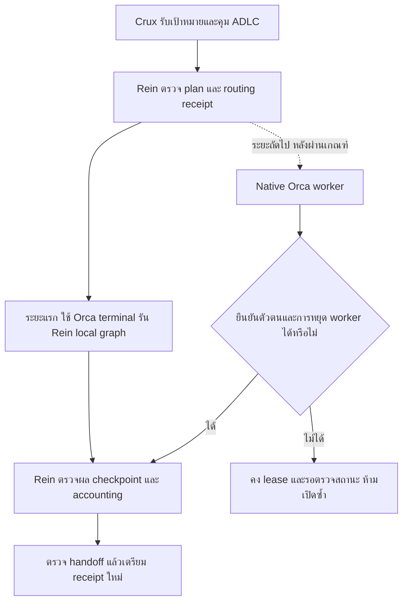
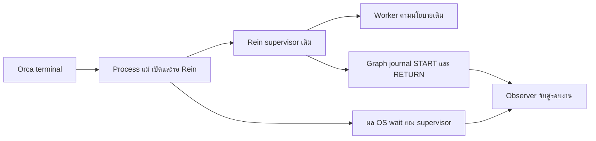
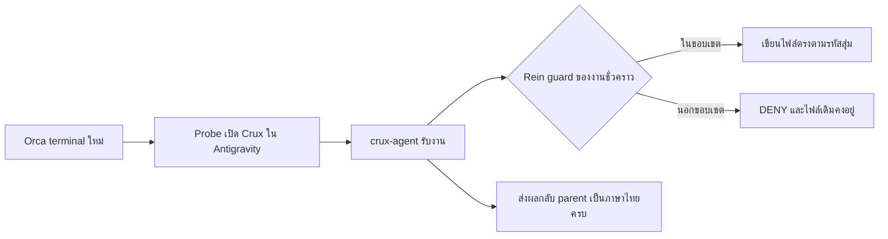

# แบบเชื่อม Rein กับ Orca

เอกสารนี้เป็นแบบพัฒนาจาก source ของ Rein และ Orca 1.4.229 ที่ตรวจวันที่ 18 ต.ค. 2026 ยังไม่ใช่ผลทดสอบวงจรจริง เป้าหมายคือให้ Crux คุม ADLC และส่งงานข้าม harness โดย Rein เป็นเจ้าของ contract, routing, lease, checkpoint และ accounting ส่วน Orca จัดการ transport และ worker

## เส้นทางที่จะทำ



ระยะแรกช่วยพิสูจน์ว่า Orca เป็นช่องทางรัน Rein ได้ แต่ยังต้องทำ native worker และ remote recovery ให้ครบตามระยะถัดไป การผ่าน local transport ไม่ได้ลดขอบเขตเป้าหมายเดิม

## ตัวเชื่อม local supervisor ที่เพิ่มแล้ว

ใช้ [orca-local-supervisor.py](../scripts/orca-local-supervisor.py) ส่งทั้ง `rein supervisor run` เข้า terminal ใหม่ โดย Rein เดิมเป็นเจ้าของ controller, graph, lease และ accounting เพียงตัวเดียว ค่าเริ่มต้นเป็น preview และไม่เรียก subprocess ต้องระบุ `--execute` จึงเปิด terminal ได้ ตัวเชื่อมนี้ใช้ POSIX shell และปฏิเสธ Windows ก่อน dispatch

```sh
python3 plugins/crux/scripts/orca-local-supervisor.py
```

เพิ่ม `--format text` เพื่ออ่านสถานะภาษาไทยแบบกระชับ ใช้ได้ทั้ง preview และการส่งงานจริง ส่วนค่าเริ่มต้นยังเป็น JSON สำหรับโปรแกรม ข้อความไทยแยกการรับคำสั่งออกจากความสำเร็จของงาน และเก็บ error ต้นฉบับไว้ การเลือกภาษาไม่เพิ่มการเรียกโมเดลหรือเปลี่ยนนโยบายส่งงาน

เมื่อมี schema-2 plan, run marker และสิทธิ์ของงานที่ตรวจแล้ว ให้ระบุ absolute canonical paths ของ `--rein`, `--plan`, `--orca` และ `--receipt` โดยเก็บ receipt นอก contracted checkout ตัวเชื่อมเรียก validator เดิมก่อนสร้าง terminal เปล่า จากนั้นตรวจ runtime ID, worktree, local execution host และ PTY ให้ตรงกันก่อนส่งคำสั่ง ต้องได้ durable prompt receipt ที่ผูก handle, request ID และ process incarnation จึงรายงานเพียงว่าส่งคำสั่งแล้ว ไม่อ้างว่างานจบ

ต้องระบุ `REIN_PROFILE` ของเจ้าของงานอย่างชัดเจน ตัวเชื่อมส่งต่อเฉพาะตัวแปรเส้นทางของ Rein ที่อนุญาต พร้อมเก็บ digest ของ profile และตรวจซ้ำก่อนส่งคำสั่ง ตัวแปรที่ไม่ได้ตั้งจะถูกล้างจาก environment ของคำสั่งใหม่ เพื่อไม่เผลอใช้ config ของ Orca แทนชุดที่ validator ตรวจ ไม่ส่งต่อ credentials หรือ `PATH` ผ่านข้อความ terminal และไม่สร้างงบหรือ controller อีกชุด

**การยกเลิกยังไม่ครบ:** API ที่ตรวจยืนยัน PTY ได้ แต่ยังไม่มี current process incarnation/generation ให้เทียบกับคำขอเดิม `--cancel` จึงรายงานข้อจำกัดและไม่ส่ง interrupt หรือปิด terminal เพื่อไม่กระทบงานใหม่ที่อาจใช้ PTY เดิม ต้องเพิ่มหลักฐาน exact supervisor process และ graph termination ก่อนเปิดทางยกเลิกอัตโนมัติ

ผลทดสอบออฟไลน์ครอบคลุม identity ผิด, host ผิด, plan ไม่ผ่าน, receipt หาย, timeout, quoting และการไม่ retry คำขอที่ไม่ทราบผล รวมถึงการปฏิเสธ workspace ที่ยังไม่ลงทะเบียนหรืออยู่บน host อื่นก่อนสร้าง terminal

ทดสอบจริงวันที่ 18 ตุลาคม 2026 ใน run `crux-negative-56c4c32592`: เปิด terminal ผ่าน Orca แล้ว Rein production graph หยุดที่ `prepare:error` เพราะ config ปิด model calls ไว้ plan hash ตรงกับ marker/receipt/journal ไม่มี discovery, probe หรือ worker ถูกเรียก และไม่มี ledger หรือ hold ค้าง หลักฐานเก็บใน `crux-orca-graph-negative-tn_2t1ja/REPORT.md` กับ `verification.json` ใต้พื้นที่ run ภายนอก repo ผลนี้ยังไม่พิสูจน์เส้นทางที่โมเดลทำงานสำเร็จ

**ช่องว่างจาก pilot แรก:** shell รับ input แล้ว แต่ prompt receipt มี `observation=unsupported` ตัวเชื่อมจึงยังรายงานไม่ยืนยันและไม่ส่งซ้ำ แม้ journal ยืนยันว่า Rein เริ่มทำงานแล้ว terminal รายงาน exited แต่ `stop_unverified` จึงยังไม่มีหลักฐาน process termination ที่ครบจาก terminal ไม่ปิด terminal จากข้อมูลนี้ การตรวจ registered worktree เพิ่มหลัง pilot แรกและผ่าน regression test; pilot invocation รุ่นถัดมาจึงทดสอบ code revision ที่มี preflight นี้แล้ว

แนะนำปิดการยืนยัน prompt/process ของ shell transport ต่อ ข้อดีคือแก้จุดที่พบจากระบบจริงโดยไม่ต้องเรียกโมเดลซ้ำ ข้อจำกัดคือยังต้องพิสูจน์เส้นทางทำงานสำเร็จ การตรวจอิสระ และการยกเลิกก่อนรับรอง lifecycle

## ยืนยัน OS exit ของ supervisor ด้วย process แม่

ตัวเชื่อมส่งคำสั่งผ่าน `supervisor-process.py` เพื่อเปิด Rein เป็น child โดยตรงและรอผลจาก OS ด้วย `Popen.wait()` เก็บ process receipt แยกจาก transport receipt โดยใช้ไฟล์ใหม่ที่สงวนครั้งเดียวและเขียนแบบ atomic ไม่สร้าง controller, ledger หรือกฎ retry เพิ่ม



Observer จับคู่ nonce, run, plan/profile hashes, repo, argv และ child PID กับ graph START ก่อนแสดง `supervisor_process_termination=verified_by_parent_wait` ส่วน `process_termination` ยังคง `not_verified` เพราะผลรอ child เดียวไม่พิสูจน์ descendants ทั้งหมด รหัสออกจริงอาจต่างจาก `cli_exit` ที่ graph ตั้งใจคืน เช่น process ถูก signal หลัง graph คืนผลแล้ว ต้องเก็บทั้งสองค่าตามจริง

SIGINT/SIGTERM ส่งต่อได้เฉพาะ child ที่ process แม่เปิดเองผ่าน `Popen` ที่ยังถืออยู่ ไม่อ่าน PID จาก receipt มาสั่ง kill ไม่มีสิทธิ์ cancel จากภายนอกเพิ่ม หาก process แม่หายก่อนบันทึกผล ให้คงสถานะไม่ยืนยันและไม่ส่งซ้ำ

**ผลจริง:** run `crux-wait-a7483a158d` ในพื้นที่ `crux-orca-parent-wait-slbop24i` เปิด Rein ผ่าน Orca และ process แม่รอ child โดยตรงแล้ว บันทึก `phase=exited`, `process_exit_code=1` ตรงกับ graph ที่ปฏิเสธตาม config ปิด model calls Observer จับคู่ child PID/nonce กับ START/RETURN ได้ และแสดงยืนยัน OS exit ของ supervisor ทั้ง JSON และภาษาไทย รอบนี้ไม่เรียกโมเดล ไม่เปลี่ยนสถานะ Orca prompt observation และยังไม่รับรอง descendants หรือการยกเลิกงานจริง

## ข้อจำกัดที่พบจริง

### อ่านผลของ Rein แยกจาก Orca prompt observation

ตัวเชื่อมสร้าง `invocation_id` แบบสุ่ม 64 ตัวอักษร hex ต่อการส่งหนึ่งครั้ง บันทึกก่อนส่ง และแนบ `REIN_SUPERVISOR_INVOCATION` ในคำสั่ง ข้อมูลนี้ใช้จับคู่หลักฐาน ไม่ใช่สิทธิ์เปิดงานหรือสั่งหยุด Controller เดิมของ Rein ตรวจสิทธิ์และเขียน START/RETURN ลง graph journal เดิม โดยผูก run, plan hash, marker digest, repo และ PID/start ไม่สร้าง controller หรือ ledger เพิ่ม

อ่านผลโดยไม่ส่งคำสั่ง Orca และไม่เขียน receipt:

```sh
python3 plugins/crux/scripts/orca-local-supervisor.py --observe --rein /absolute/rein --receipt /absolute/transport.json --format text
```

`graph_started` แปลว่า Rein บันทึกการเริ่มรอบนั้นแล้ว `graph_returned` แปลว่าฟังก์ชัน graph คืนผลตามบันทึกแล้ว ต้องอ่าน state/error ประกอบ ไม่แปลว่างานผ่านทั้งหมด ค่า `cli_exit` เป็นค่าที่ CLI ตั้งใจคืน ไม่ใช่ OS wait result และไม่ยืนยัน process หรืองานลูกหยุด ห้ามใช้ข้อมูลนี้สั่ง kill, close, settle หรือ retry แทนหลักฐานเดิม หาก nonce เก่าหรือจับคู่ไม่ได้ ให้คงสถานะไม่ยืนยันและไม่ส่งซ้ำ

การตรวจออฟไลน์ครอบคลุมรหัสซ้ำ, panic, journal ผิดรูป, marker เปลี่ยน, การบันทึกล้มเหลว และการอ่านแบบไม่เขียนข้อมูล ต้องตรวจผลจาก Orca จริงแยกจากผลเหล่านี้

**ผลจริงของ invocation observer:** run `crux-invocation-bd51acf4b0` ในพื้นที่ `crux-orca-graph-invocation-ugk964il` ส่งผ่าน Orca หนึ่งครั้ง แล้วอ่าน JSON/ภาษาไทยได้ `graph_returned` ทั้งคู่ โดย nonce, run, plan hash, marker digest และ PID/start ตรงกับ START/RETURN ผลคือ config ปิด model calls จึงหยุดก่อน worker การอ่านไม่เปลี่ยน receipt และไม่ส่งงานซ้ำ หลักฐาน `observe-json.json`, `observe-text.json` และ graph journal อยู่ในพื้นที่ run ดังกล่าว ไม่ถือว่า Orca prompt observation รองรับแล้วหรือ process หยุดครบแล้ว

| จุด | หลักฐานจาก source | ผลต่อแบบ |
| --- | --- | --- |
| Graph จบงานด้วย PID/start/process group | [graph adapter](../../../cmd/rein/graph_adapter.go), บรรทัด 126–163 และ 431–437 | ห้ามใช้ exit ของคำสั่งเปิด Orca แทน exit ของ worker |
| Graph ปฏิเสธ remote launch | [route launch](../../../cmd/rein/route_launch.go), บรรทัด 73–94 | คง fence จนมีหลักฐาน guard, stop และ settlement |
| Remote lease ยังไม่มี completion path | [lease](../../../internal/routing/lease.go), บรรทัด 49–84 และ 239–287 | เพิ่มการปลดเฉพาะ exact identity หลังยืนยัน writer หยุด ไม่เรียก CompleteLocal แทน |
| Direct Orca launcher สร้าง worktree ใหม่และใช้ legacy controller | [Orca launch](../../../internal/orca/orca.go), บรรทัด 160–174 | ไม่เรียกซ้อนจาก graph ที่มี contract/worktree/controller แล้ว |
| Retry ตรวจ execution/checkpoint/accounting/cooldown | [recovery](../../../cmd/rein/graph_recovery.go), บรรทัด 21–68 | ต้องรักษาลำดับเดิม ไม่ใช้ข้อความ worker_done แทนหลักฐาน |
| Checkpoint/verify ใช้ filesystem ของ controller | [checkpoint](../../../internal/routing/checkpoint.go), บรรทัด 87–143 | งานคนละ host ต้องส่ง snapshot และตรวจ identity/digest ก่อนนำกลับมาใช้ |

Orca ที่ติดตั้งประกาศ `orchestration.worker-stop-verdict.v1` และ `orchestration.federation-lifecycle-settlement.v1` แต่ capability name ไม่ใช่หลักฐานว่า worker จริงหยุดแล้ว Source ที่ติดตั้งแยกดังนี้:

- **Local PTY:** ตรวจ resource ownership และผล `close.ptyKilled` แต่ยังต้องพิสูจน์ worker/descendants ภายใต้ policy ของ Rein ด้วยการทดสอบจริง
- **Local structured session:** รอ host close และตรวจ session ไม่ attached แล้ว ผลนี้ยังไม่ได้พิสูจน์ OS process group หรือ descendants แบบที่ Rein ใช้
- **Federation structured session:** handler ในรุ่นนี้ต้องการ exact terminal observation และไม่มี structured-close branch แบบ local จึงเป็นช่องว่างของ runtime ที่ติดตั้ง ต้องมี runtime ที่รองรับหรือ host-side proof ที่ตรวจได้ก่อนเปิด recovery เส้นทางนี้
- **Adopted worker:** การ stop อาจปิด assignment โดยไม่หยุด process จึงรับ `state=stopped` หรือ exit 0 อย่างเดียวไม่ได้

## การตรวจ worker ที่เพิ่มในเส้นทางเดิม

`rein route launch` ของ Orca บันทึก task/dispatch ลง lease ก่อนเรียก `worker-show` โดยใช้ executable, environment, cwd และ API endpoint เดิม ตรวจไม่เกิน 10 วินาทีและรับ stdout ไม่เกิน 1 MiB ไม่ส่ง `--on` ของ execution host ไปใช้แทน API home และไม่เก็บ pairing code ลง ledger

จะรายงานพร้อมทำงานต่อเมื่อ run/task/dispatch/worker ตรงกัน, worker เป็น ready และ observation ระบุ exact/live โดยไม่มี projection ที่ขัดแย้งหรือ `addressable:false` ส่วน structured worker ที่ไม่มี terminal ใช้ได้ ข้อมูลหาย ผิดตัว เกินขนาด หรือหมดเวลาต้องรายงานล้มเหลวและคง lease/งบไว้ ผลพร้อมทำงานนี้ไม่ใช่หลักฐานหยุด process และไม่ปลด remote recovery หรือเปิด Orca graph ที่ยังไม่รองรับ ตัวตรวจใช้ร่วมกับ `internal/orca.Launch` เพื่อลดกติกาที่ซ้ำกัน

ชุดทดสอบใช้ subprocess จำลองและไม่มีการเรียกโมเดลหรือ provider จริง จึงพิสูจน์การตรวจข้อมูลและการรักษา fence ในเครื่องเท่านั้น ต้องแยกผลนี้จาก live worker lifecycle และการบังคับเพดานค่าใช้จ่ายของ provider

## งานพัฒนาตามลำดับ

| ลำดับ | งานและเจ้าของเดิม | เกณฑ์ก่อนผ่านขั้น |
| --- | --- | --- |
| 1 | เตรียม local plan ตาม [คู่มือ](local-plan.md) แล้วใช้ terminal ใหม่ของงานนี้รัน Rein เดิม | contract/hooks/profile/งบจริงพร้อม; graph guard, checkpoint, verify และ lease มีหลักฐานจริง |
| 2 | เพิ่มชนิด Orca execution evidence ใน graph adapter และ internal/orca ผ่าน Operations เดิม | run/task/attempt/decision/dispatch/worktree/host และ worker incarnation ตรงกับ fresh observation; ไม่ยัด handle ลง PID |
| 3 | เพิ่ม remote completion ใน routing lease ภายใต้ lock เดิม | stop proof ผูก exact dispatch/resource/ownership; ข้อมูลไม่ครบต้องคง fence |
| 4 | เชื่อม stop intent/result → checkpoint → settlement → continuation ผ่าน journal เดิม | source writer หยุดแล้วก่อน snapshot/retry; usage ที่ไม่ทราบไม่ถูกคิดเป็นศูนย์ |
| 5 | รองรับ snapshot ข้าม host และเปิดแต่ละ harness/transport หลังผ่าน live test | source/destination workspace, base/head, contract และ digest ตรวจครบ; native guard/model/effort forwarding ผ่าน |

ข้อ 1 ใช้คำสั่งจาก interface ที่มีอยู่แล้ว โดยแทน placeholders จากข้อมูลที่ตรวจจริงและ quote shell ให้ถูกต้อง:

```text
orca terminal create --worktree path:<exact-local-worktree>
  --command 'exec <absolute-rein> supervisor run --plan <absolute-frozen-plan>' --json
```

ตัวอย่างเป็นคำสั่งเดียวที่แบ่งบรรทัดให้อ่าน ไม่ใช่คำสั่งพร้อมคัดลอกรัน ต้อง bind run/plan/controller ตามขั้นตอนเดิมก่อน เริ่มจาก terminal ใหม่ของงานนี้เท่านั้น Plan ยังคงเลือก direct-shell provider เพื่อให้ Rein ส่ง guard flags และติดตาม process group เอง `terminal wait --for exit` เป็นหลักฐานประกอบ ไม่แทน graph execution

ข้อ 2–5 ใช้ [Operations](../../../internal/supervisor/graph.go), journal และ routing ledger ที่มีอยู่ ไม่เพิ่ม scheduler, retry ledger หรือ worktree owner อีกชุด ต้องรักษา dispatch-pending ก่อนเรียก remote และกู้ acknowledgement ด้วย request identity เดิมเมื่อ API รองรับ ห้ามเปิด worker อีกตัวเพราะคำตอบหาย

## หลักฐานที่ต้องตรวจรับ

| เรื่อง | ต้องผูกกับอะไร | สิ่งที่ยังไม่ถือว่าผ่าน |
| --- | --- | --- |
| Authority | current plan hash, contract/config digest, run/task/attempt/decision/hold | env, prompt label หรือไฟล์จาก worker ที่อ้างว่าอนุมัติแล้ว |
| Worker/host | Orca run/task/dispatch, worktree, resource kind, host/environment และ incarnation/epoch ตาม field ที่ API คืนจริง | ชื่อ host, title หรือ handle ที่ไม่ได้ตรวจ scope; ห้ามแต่ง field ที่ receipt ไม่มี |
| Termination | exact resource incarnation และ typed close/stop proof หรือ authoritative exited observation | exit 0, alreadySettled, release_pending, abandoned, assignment-only stop หรือ timeout |
| Artifact | source workspace/base/head/contract และ snapshot digest หลัง writer หยุด | ไฟล์ที่แก้ระหว่างส่งต่อ หรือ checkpoint acknowledgement อย่างเดียว |
| Accounting | attempt/hold/pool และผล settlement | ไม่มี usage แล้วสมมติว่าเป็นศูนย์ |
| Handoff | execution/checkpoint digests เดิมและ receipt ปลายทางที่ออกใหม่ | เริ่มผู้รับก่อน source writer หยุดหรือก่อนตรวจ guard/input ของผู้รับ |

## เกณฑ์ทดสอบก่อนเปิด remote fence

1. Local live: งานที่อยู่ใน contract ทำได้ และการเขียนนอก contract ถูกปฏิเสธจริงจาก native harness ผ่าน Orca พร้อมตรวจ revision สุดท้าย
2. Stop live: หยุด worker ที่ยังทำงานตาม exact dispatch แล้วพิสูจน์ writer/descendants ตาม policy ก่อน retry
3. Unknown: transport หายระหว่าง start/stop ต้องไม่มี worker ตัวที่สองและ lease ยังถูกถือไว้
4. Identity: dispatch, worktree, host/runtime epoch หรือ process incarnation เปลี่ยน ต้องปฏิเสธหลักฐานเดิม
5. Receipt: exit 0 ที่เป็น assignment-only/already-settled หรือ exactWorker=false ต้องไม่ปลด lease
6. Artifact/accounting: digest เปลี่ยนหรือ settlement ไม่ครบ ต้องไม่เริ่ม provider ถัดไป
7. Federation structured: พิสูจน์ stop ของ worker จริงได้โดยไม่อาศัย PTY ที่ไม่มี ก่อนเปิด recovery สำหรับชนิดนี้
8. Handoff จริง: สอง provider รับช่วงงานเดียวกันผ่าน receipt/checkpoint ที่ตรวจแล้ว ผู้รับใช้ context จริง และรายงานภาษาไทยโดยรักษาคำสั่ง/error ต้นฉบับ

ผลปัจจุบันยังไม่ผ่านเกณฑ์ live เหล่านี้ การพัฒนา adapter/lease/evidence ทำต่อได้ แต่การประกาศ remote recovery พร้อมใช้งานต้องรอหลักฐานครบและแก้ช่องว่าง runtime ที่ระบุไว้


## ผลทดสอบ local transport จริง

วันที่ 18 ต.ค. 2026 ใช้ Orca 1.4.229 ที่ runtime พร้อม สร้าง terminal ใหม่หนึ่งตัวใน workspace ที่ลงทะเบียนแล้ว จากนั้น startup command เรียก probe ที่เปิด Antigravity 1.4.2 ใน **contracted workspace ชั่วคราวอีกแห่ง** โดยกำหนด cwd และติดตั้ง Rein hooks ที่ตรงกับงาน ไม่ได้ลง hooks ใน coordinator workspace และไม่ได้เรียก native `worker-start` หรือ `rein supervisor`



หลักฐานจริงมี parent/child conversation ID, child transcript, PID/start/process group, terminal handle/incarnation/runtime ID, exact file bytes และ DENY/seen logs ที่ generation เดียวกัน Child อ่าน shared instructions แล้วเขียนไฟล์ใน `allowed/**` ได้ การเขียน `forbidden.txt` ถูกปฏิเสธหนึ่งครั้ง จากนั้นส่ง error เดิมให้ parent และ final `DONE` Parent เรียกเฉพาะ `invoke_subagent`; คำตอบรอบนี้ครบ ไม่มี print-timeout diagnostic และ CLI จบ exit 0 ตรวจแยกพบ CLI/probe PID หายและไม่มีสมาชิก process group ของ probe ก่อนลบพื้นที่ชั่วคราว

ระหว่างอ่านคำสั่ง child เดา leaf skill เป็นโฟลเดอร์ `principles/` แล้วได้ file-not-found ก่อนค้นพบ path จริงและอ่านสำเร็จ จึงเพิ่ม relative path ของ leaf ใน shared `crux-mode` โดยตรง ผล native ข้างต้นเกิดก่อนการเพิ่มคำแนะนำนี้ ยังไม่ได้เรียกโมเดลซ้ำเพื่อยืนยันว่าจะไม่เดาผิดอีก

Orca `terminal wait` คืน `status=exited`, `exitCode=0` แต่ `exitCause` เป็น `unknown/host_status_unavailable` จึงไม่ใช้ terminal receipt นี้แทน process proof ภายหลัง `close --tab` ของ handle เดิมถูกปฏิเสธ `terminal_handle_stale` และไม่พบ handle/tab ใน live inventory ไม่ได้พิสูจน์การลบ ended tab จาก durable UI state ห้ามปิดทุก terminal หรือเดา handle ใหม่เพื่อเก็บกวาด

**ขอบเขตผลผ่าน:** local terminal transport, native Crux implementation delegate, Rein write guard และการส่งผลภาษาไทยในตัวอย่างนี้ ยังไม่ใช่ supervised graph ที่ผ่าน owner policy/calibration, native Orca worker lifecycle, forced stop ขณะทำงาน, remote/federation termination, accounting จริง หรือ handoff ข้าม provider ไม่เปิด remote fence จากผลนี้

## ผลเพิ่ม: production graph ด้วย worker จำลองผ่าน Orca

วันที่ 18 ต.ค. 2026 run `crux-fixture-39aa40cf6d` ใช้ wrapper และ parent-wait helper ส่งเข้า terminal ใหม่ของ Orca แล้วรัน production Rein graph จริง เส้นทาง prepare → launch → observe → finish จบที่ `WAITING_HUMAN` พร้อมงานที่ตรวจแล้ว 1 งาน สร้าง execution receipt กับ checkpoint และตรวจ checkpoint ผ่าน คำสั่งตรวจ hold คืน `null` ไม่มีรายการจองค้าง

Process แม่ได้ supervisor exit 0 จาก OS โดยตรง การตรวจเพิ่มเติมพบ worker/verifier PID และ process group หายแล้ว Observer จับคู่ nonce/run/plan/profile/child PID และคืนทั้ง JSON กับคำอธิบายไทย โดย transport/process receipt ไม่เปลี่ยน

**ส่วนที่จำลอง:** catalog, probe, worker, verifier, quality ledger และงบ ใช้ executable ส่วนตัวในพื้นที่ run แยกทั้งหมด ไม่มี native model request Usage ของ worker ที่ไม่ทราบถูกคิดตามยอดจอง หลักฐานจึงรองรับ control flow, process, artifact และ accounting ของ fixture นี้ ไม่ยืนยันคุณภาพโมเดลหรือความพร้อมทั้งสี่ harness

หลักฐานอยู่ใน run ภายนอก repo `crux-orca-graph-fixture-c3nuzmym`: `observe-json.json`, `checkpoint-verify-result.json`, `process-liveness-after.json`, `route-holds-after.json` และ `fixture-policy-disclosure.json` ผลนี้ยังไม่เปิด native Orca worker/remote fence และไม่ใช้ receipt/PID เป็นสิทธิ์ยกเลิกงาน

รอบถัดมาเข้า completed graph เดิมผ่าน terminal ใหม่และ invocation nonce ใหม่ ผลจบเหมือนเดิมโดยไม่เพิ่ม catalog/probe/worker/verifier หรือ ledger/hold มีเพียง lifecycle START/RETURN เพิ่มใน journal หลักฐาน plan/config/profile/marker/receipt/checkpoint/accounting ก่อน–หลังตรงกัน 11 ไฟล์ ดู `resume-verification.json` และ `evidence-sha256.json` ของ run เดิม นี่เป็น completed-graph resume ไม่ใช่การพิสูจน์ crash recovery หรือการส่งต่อโมเดลจริง
